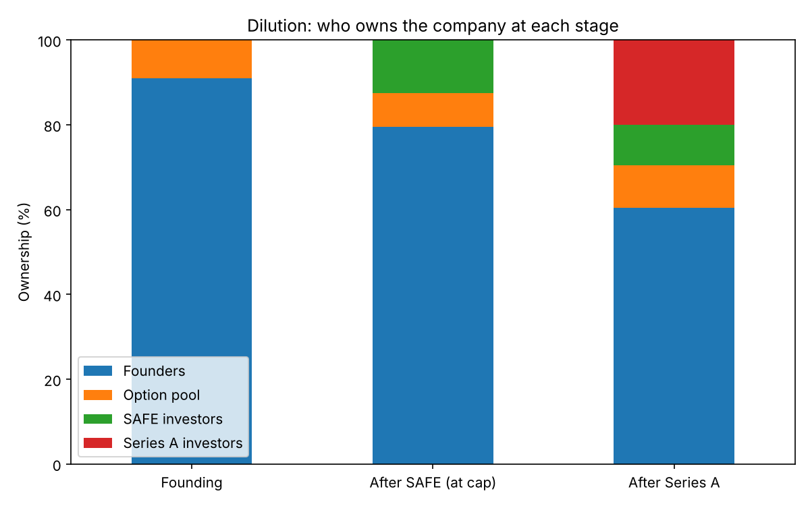
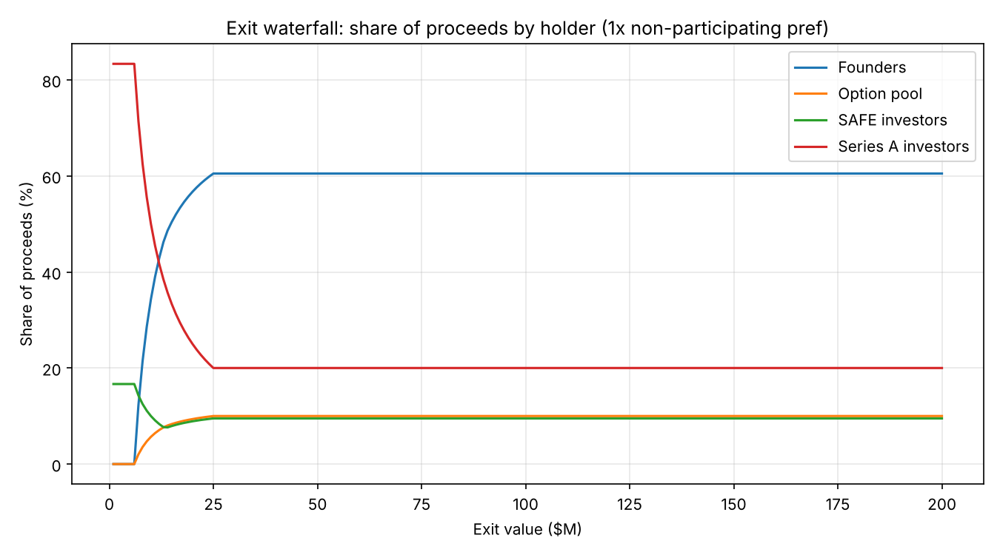

# Startup Cap Table & Exit Waterfall Model

A small Python model that follows one startup from **founding → post-money SAFE → Series A → exit**,
and shows who owns what at each stage and who gets paid at different exit values.

Built to practise the deal mechanics a VC analyst needs to be fluent in: dilution, option pool top-ups,
SAFE conversion and liquidation preferences.

**Author:** Paras Taneja

## What it models

| Stage | Assumption (editable in `Assumptions`) |
|---|---|
| Founding | Founders 10,000,000 shares, existing option pool 1,000,000 shares |
| Seed | $1M post-money SAFE, $8M valuation cap, no discount |
| Series A | $20M pre-money, $5M raise, option pool topped up to 10% post-round (inside the pre-money) |
| Exit | 1x **non-participating** liquidation preference; SAFE and Series A are pari passu; each investor takes the better of preference or conversion |

## Results with the default assumptions

**Ownership over time**

| Stage | Founders | Option pool | SAFE | Series A |
|---|---|---|---|---|
| Founding | 90.9% | 9.1% | – | – |
| After SAFE (at cap) | 79.5% | 8.0% | 12.5% | – |
| After Series A | 60.5% | 10.0% | 9.5% | 20.0% |

**Exit scenarios (selected)**

| Exit value | Founders' share of proceeds | Series A MOIC | SAFE MOIC |
|---|---|---|---|
| $5M | 0.0% | 0.83x | 0.83x |
| $10M | 34.3% | 1.00x | 1.00x |
| $30M | 60.5% | 1.20x | 2.85x |
| $100M | 60.5% | 4.00x | 9.51x |

What this shows:
- **Below ~$6M** (the combined preference stack) founders and the option pool get nothing. Investors are paid first and share the loss pro rata.
- **Between roughly $6M and $25M** preferences distort the split. Founders' share of proceeds is below their 60.5% ownership.
- **Above ~$25M** both investors convert to common and proceeds follow ownership.
- The SAFE earns a much higher multiple than the Series A because it converted at a lower price (about $0.64 vs $1.51 per share).




## Run it

```bash
pip install -r requirements.txt
python src/run.py          # prints tables, writes CSVs and charts to outputs/
python tests/test_model.py # sanity checks (ownership sums to 100%, value is conserved, etc.)
```

Change the numbers in `Assumptions` (in `src/model.py`) to test other deals, e.g. a lower cap or a bigger pool.

## Files

- `src/model.py`: cap table solver (fixed-point iteration, because the Series A price and the SAFE/pool share counts depend on each other) and exit waterfall
- `src/run.py`: runs the default scenario and saves outputs
- `tests/test_model.py`: checks for ownership, pool target, SAFE ownership at cap, value conservation
- `outputs/`: generated charts and CSVs

## Limitations

- No SAFE discount, no pro-rata rights, no senior/junior preference stacking, no participating preferred.
- Option pool treated as fully exercised, strike price ignored.
- Single priced round after the SAFE. Real deals add more rounds, bridge notes and negotiated terms.

## Possible extensions

Add a Series B, model a SAFE discount, compare participating vs non-participating preferred, or add seniority between rounds.

## License

MIT
